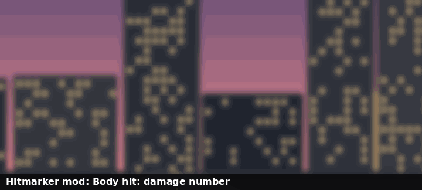
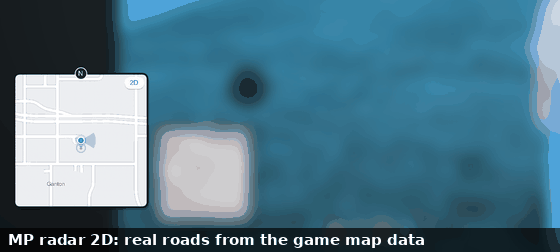

# Features

The GIFs are generated on a PC by running MP's own code (radar, compass, sync blips, RP screens, the Hitmarker mod and the HG rules). No screenshots or screen recordings are used; only the backgrounds are drawn for the GIF.

## Online play and sync

Everything below is synced between players:

- **Movement and animations:** position, walk / run / sprint, crouch, jump, climb, fight and aim
- **Players:** health and armour, deaths, clothes and skins, interiors
- **Vehicles:** model, speed, colours, paintjob, tuning, damage, doors and locks
- **Shots:** every bullet and rocket
- **World:** NPC people and traffic, weather and time
- **Body build sync (4.13.62):** a muscular or fat CJ looks the same to other players.
- **Car exits (4.13.62):** players open the door, climb out and shut it; they jump out only from a moving car.
- **Drive-by sync (4.13.61):** lean out of a car window to shoot as a passenger or driver and the others see the real GTA SA drive-by animation aimed where you aim, with your bullets synced. Works on every server.
- **Moquil chats (4.13.61):** after linking Moquil (Social > Moquil > link code), your Moquil friends and chats show up in the game's Social > Chats and Friends pages, and the other way around.
- **Call sync (4.13.58):** on a phone call your character takes out the phone and holds it to his ear. Others see the animation and the phone in his hand on every server, and your weapon comes back when the call ends. Mega Vil Futuristic RP has its own RP phone.

You also get name tags with health and armour bars, player blips in each player's color, chat with its own keyboard, voice chat (40 m range) and a kill feed.

## Combat

- The shooter decides the damage.
- Hit markers show kills, headshots, explosions and armour hits.
- Drive-bys work, and the car HUD shows speed, fuel and health.
- The server has an anti-cheat.

## Radar, maps and HUD

- **MP radar:** 2D (north up) or 3D (turns with you). It is drawn from the game's own roads, water, parks and district names, and has a GPS route.
- **Compass:** heading, waypoints and distance.
- **Full map:** player and property blips.

## Main menu, loading and pause

The game's main menu gets a **[MultiPlayer]** button, plus a custom loading screen and loading window.
