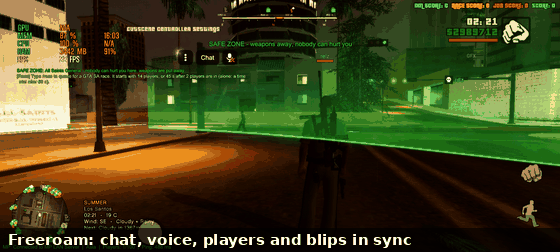
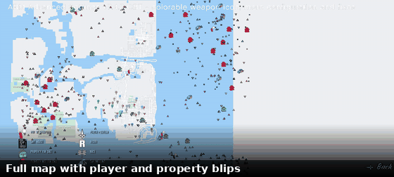
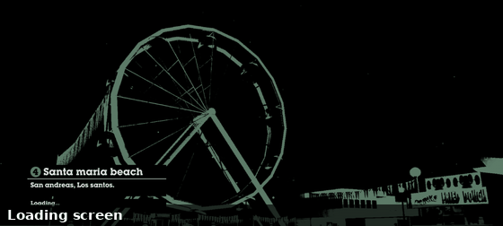

# Features

The GIFs are made from real in-game screenshots. The radar GIF comes from MP's real radar drawing code, run on a PC. None of them are screen recordings.

## Online play and sync

Everything below is synced between players:

- **Movement and animations:** position, walk / run / sprint, crouch, jump, climb, fight and aim
- **Players:** health and armour, deaths, clothes and skins, interiors
- **Vehicles:** model, speed, colours, paintjob, tuning, damage, doors and locks
- **Shots:** every bullet and rocket
- **World:** NPC people and traffic, weather and time
- **Phone calls (4.13.58):** in a Mega Vil phone call your character takes out the phone and talks. Others see the animation and the phone in its hand, and your weapon comes back when the call ends.

You also get name tags with health and armour bars, player blips in each player's color, chat with its own keyboard, voice chat (40 m range) and a kill feed.

## Combat

- The shooter decides the damage.
- Hit markers show kills, headshots, explosions and armour hits.
- Drive-bys work, and the car HUD shows speed, fuel and health.
- The server has an anti-cheat.

## Radar, maps and HUD

- **MP radar:** 2D (north up) or 3D (turns with you). It is drawn from the game's own roads, water, parks and district names, and has a GPS route.
- **Compass:** heading, waypoints and distance.
- **Full map:** player and property blips.

## Main menu, loading and pause

The game's main menu gets a **[MultiPlayer]** button, plus a custom loading screen and loading window.
