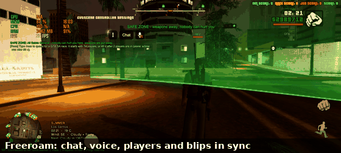

# MP Multiplayer wiki

MP is an online multiplayer mod for **GTA San Andreas** (2.00, 32-bit and 64-bit) and **GTA Vice City** on Android. It is loaded by AML (`libMP32.so` / `libMP64.so`).

Download, guide and news: **https://mpsamp-open.github.io**

## Pages

- [Install](Install.md)
- [Features](Features.md)
- [Servers and hosting](Servers-and-Hosting.md)
- [Server Management](Server-Management.md)
- [Gamemodes](Gamemodes.md)
- [MonetLoader mods](MonetLoader-Mods.md)
- [Vice City](Vice-City.md)
- [FAQ](FAQ.md)

Current version: **4.13.58**.
