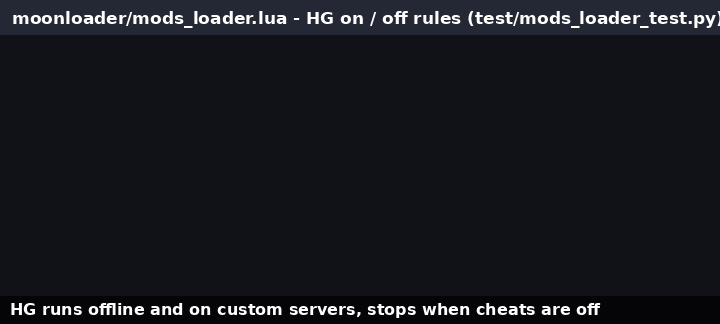

# MonetLoader mods

`moonloader/mods_loader.lua` starts every `.lua` right inside `moonloader/mods/`. Old copies left in `moonloader/` are stopped and renamed to `.lua.old`.

## lua_scripts folder (.lua, .luac and .zip)

`moonloader/lua_scripts_loader.lua` is the entry point of `moonloader/lua_scripts/`:

- every `.lua` / `.luac` in `lua_scripts/` and its sub folders starts (the [moonloader-scripts](https://github.com/ThirtyFoxMCx00E1/moonloader-scripts) collection is in `lua_scripts/moonloader-scripts/`);
- every `.zip` is unpacked to `lua_scripts/.unpacked/<zip name>/` and its scripts start from there: at the top of the zip, in a folder, or in a PC-style `moonloader/` folder (see `lua_scripts/hitmarker.zip`);
- `lib/`, `config/`, `resource/`, `resources/` and a folder named like the script are copied into `moonloader/` (missing files only); a zip without a script is copied as data;
- PC scripts with `\\` paths work (`lib/mp_pcpaths.lua`);
- `lua_scripts/disabled.txt` keeps scripts from starting; `/luascripts list` shows what runs, `/luascripts rescan` starts them again.
- a folder (or zip) with its own `lib/` is a self-contained mod: its files stay inside it, `getWorkingDirectory()` is that folder for the mod, and `moonloader/lib` is searched before its own `lib/` (example: `lua_scripts/Hasslehud/`, HassleHUD Android 1.0, `/hasslehud`).

## Script Manager

Tap the moon icon on the top bar (⋮ / chat / mic / moon). The Script Manager for MonetLoader has:

- **Scripts:** Find, Reload all, Refresh list; every script of `moonloader/`, `mods/` and `lua_scripts/` with an On / Off switch and a running dot. Tap one for File, Path, Status, version, authors, Load / Unload, Reload and Open in Shell.
- **Log:** the end of moonloader.log.
- **Last crashes:** scripts that died and their error.
- **Shell:** runs Lua inside the chosen running script (`return x` prints x).
- **Settings:** the whole `lua_scripts/` or `mods/` folder on / off, switch every script on.

The switches are saved in `moonloader/config/mp_scripts_off.txt` and stay after a restart or a rejoin.

A script that died shows **Crashed** and its error. When `lua_scripts_loader.lua` is missing or not running the Scripts tab says so (MP writes `lua_scripts_loader.lua`, `mods_loader.lua`, `lib/mp_zip.lua` and `lib/mp_pcpaths.lua` by itself when they are missing). When `lua_scripts/Hasslehud/` isn't on the phone, **Download HassleHUD (20 MB)** gets it.

| Mod | What it does |
|---|---|
| `mods/tvplayer.lua` | Plays video on the TV model in houses |
| `mods/hitmarker.lua` | Hit markers from MP's real hits (`MP_PopHit`) |
| `mods/hg.lua` | HG menu, opened with `/hg` |
| `lua_scripts/Hasslehud/` | HassleHUD Android 1.0: its own HUD panel style, opened with `/hasslehud` |

## When HG runs

HG and the CLEO menu are cheat mods.

They run:
- offline (single player)
- on custom servers whose owner allows CheatMenu + MonetLoader cheats (see [Server Management](Server-Management.md))

They never run:
- on the default server or LAN server
- on featured servers
- with "Block menu cheats"

When the owner turns cheats off, HG stops at once. It starts again where it is allowed.
